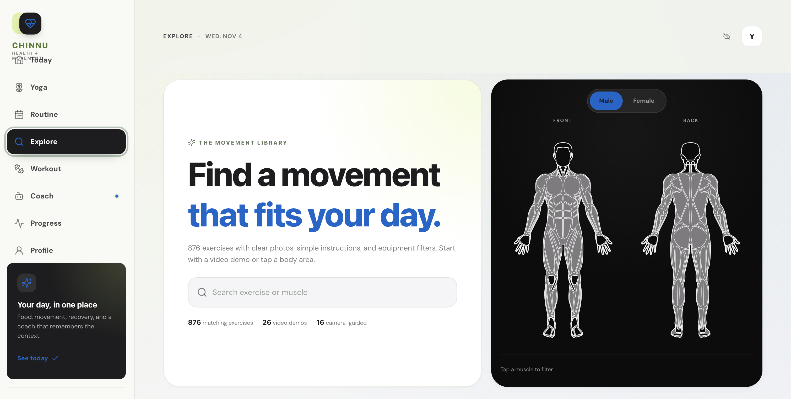
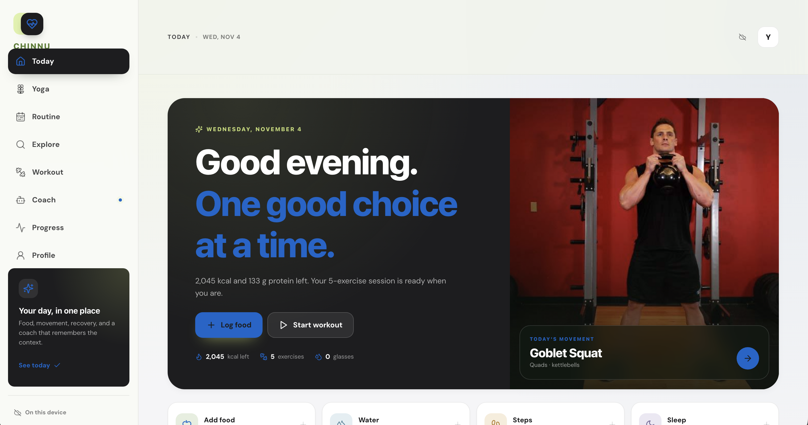

# Chinnu HealthAI

A privacy-focused health & fitness companion built for real life. Track food, movement, recovery, yoga, workouts, and get AI coaching — all in one app.

---

## Live Demo

[**https://chinnu-healthai-v2.onrender.com/**](https://chinnu-healthai-v2.onrender.com/)


---

## Table of Contents

1. [Overview](#overview)
2. [Screenshots](#screenshots)
3. [Core Features](#core-features)
4. [How It Works](#how-it-works)
5. [Architecture](#architecture)
6. [Tech Stack](#tech-stack)
7. [AI & ML Capabilities](#ai--ml-capabilities)
8. [User Flow](#user-flow)
9. [Database Schema](#database-schema)
10. [Security & Privacy](#security--privacy)
11. [Getting Started](#getting-started)
12. [Environment Variables](#environment-variables)
13. [Deployment](#deployment)
14. [Contributing](#contributing)
15. [License](#license)

---

## Overview

**Chinnu HealthAI** is a comprehensive, privacy-first health and fitness companion web application designed to help users track their nutrition, movement, recovery, and overall wellness in one unified platform. The app combines traditional fitness tracking with cutting-edge AI capabilities including computer vision for form coaching, food recognition, and an intelligent AI coach.

### Key Principles

- **Privacy-First** - Local-first data storage by default, optional cloud sync
- **All-in-One** - Food, movement, recovery, yoga, workouts, and coaching in one app
- **AI-Powered** - Intelligent coaching, food recognition, and real-time form analysis
- **Cross-Platform** - Works on desktop, mobile, and tablet via PWA
- **Offline-Capable** - Core features work without internet connection

---

## Screenshots

### Dashboard View


### Workout Interface


### Authentication Page


---

## Core Features

### 1. Today Dashboard
The main hub of the app providing an at-a-glance view of your daily health metrics:

- **Daily Overview** - Calories consumed/burned, steps, water intake, sleep hours, weight
- **Quick Actions** - One-tap logging for meals, water, steps, sleep, and weight
- **Workout Suggestions** - Personalized recommendations based on your profile and goals
- **Progress Indicators** - Visual rings and bars showing daily goal completion
- **Coach Insights** - AI-generated tips and reminders based on your data

### 2. Nutrition & Food Tracking
Comprehensive meal logging with AI-powered food recognition:

- **Manual Food Logging** - Add meals by type (Breakfast, Lunch, Dinner, Snacks) with detailed nutrition info
- **AI Food Recognition** - Snap a photo of any meal and get instant nutrition estimates
- **Macro Breakdown** - Calories, protein, carbs, fat, and fiber tracking
- **Meal History** - Complete log of all meals with timestamps
- **Portion Estimation** - AI estimates serving sizes for Indian and global cuisines
- **Multiple Sources** - Support for manual entry and camera-based recognition

### 3. Workout & Exercise
Full-featured workout tracking and planning:

- **Exercise Library** - Comprehensive database of exercises with:
  - Detailed instructions and tips
  - Muscle groups targeted
  - Difficulty levels
  - Equipment requirements
  - Video demonstrations
- **Custom Workouts** - Build and save personalized workout routines
- **Workout Player** - Guided sessions with:
  - Set and rep tracking
  - Rest timers
  - Progress indicators
  - Completion tracking
- **Routine Planner** - Create multi-day workout programs
- **Exercise Details** - In-depth guides with form cues and safety notes
- **Quick Add** - Pre-built exercise templates for fast workout creation

### 4. Yoga
Dedicated yoga practice section:

- **Yoga Library** - Collection of yoga poses and flows
- **Guided Sessions** - Step-by-step practice with form guidance
- **AI Form Coach** - Real-time pose analysis and corrections during practice
- **Pose Details** - Benefits, contraindications, and alignment tips
- **Gender-Inclusive** - Separate anatomical references for male/female body types

### 5. AI Coach
Intelligent conversational health assistant:

- **Chat Interface** - Natural conversation about fitness, nutrition, recovery
- **Context-Aware** - Understands your goals, progress, and current state
- **Practical Advice** - Actionable recommendations tailored to your needs
- **Safety-First** - Prioritizes safe exercise and evidence-based advice
- **Prompt Suggestions** - Quick-start prompts for common questions
- **Voice Support** - Voice input/output for hands-free interaction

### 6. Real-Time AI Vision Coach
Camera-based form coaching for workouts:

- **Live Camera Feed** - Real-time video analysis during exercise
- **15+ Tracked Exercises** - Squats, pushups, lunges, planks, and more
- **Live Form Cues** - Real-time feedback on form, alignment, and technique
- **Rep Counting** - Automatic rep counting with form validation
- **Phase Detection** - Identifies exercise phases (eccentric, concentric, isometric)
- **Session Saving** - Save coaching sessions with scores and feedback
- **On-Device Processing** - Pose detection runs in browser, no video sent to server

### 7. Progress & Analytics
Track your fitness journey over time:

- **Weight Tracking** - Log and visualize weight trends
- **Activity Metrics** - Steps, calories burned, active time
- **Recovery Tracking** - Sleep quality and water intake monitoring
- **Workout History** - Review past sessions and performance
- **Visual Charts** - Trend graphs for all tracked metrics
- **Body Map** - Interactive muscle group visualization
- **Performance Scores** - Track improvement over time

### 8. Profile & Cloud Sync
User management and data synchronization:

- **User Profile** - Goals, experience level, equipment, units (metric/imperial)
- **Supabase Authentication** - Secure sign-in with:
  - Email Magic Link
  - Google OAuth
  - GitHub OAuth
- **Cloud Sync** - Optional sync across devices
- **Local-First** - Works offline with localStorage
- **Per-User Security** - Row-level security (RLS) ensures data isolation
- **Settings** - Units, preferences, and app configuration

---

## How It Works

### Data Flow

1. **User Interaction** - User interacts with React frontend
2. **Local Storage** - Data saved to browser localStorage immediately
3. **Cloud Sync** (optional) - If signed in, data syncs to Supabase
4. **AI Features** - Requests routed through Supabase Edge Functions
5. **ML Processing** - On-device pose detection via TensorFlow.js

### Authentication Flow

1. User enters email or clicks OAuth provider
2. Supabase Auth sends magic link or redirects to OAuth
3. On success, user session established
4. Cloud sync begins automatically
5. User data protected by Row Level Security

### AI Processing Pipeline

**Food Recognition:**
1. User captures food image
2. Image converted to base64
3. Sent to Supabase Edge Function `food-recognize`
4. Edge Function calls NVIDIA Nemotron Vision API
5. AI analyzes image and returns nutrition data
6. Results displayed and meal saved

**AI Chat:**
1. User sends message
2. Context gathered (profile, recent activity, meals)
3. Sent to Supabase Edge Function `agent`
4. Edge Function calls NVIDIA LLaMA 3.1 70B
5. AI response streamed back
6. Message displayed in chat

**Vision Coaching:**
1. User enables camera
2. Frames captured at regular intervals
3. Frame sent to `coach-vision` Edge Function
4. AI analyzes form and returns cue
5. Cue displayed on screen
6. Pose detection also runs locally for rep counting

---

## Architecture

### Frontend Architecture

```
src/
├── App.tsx                 # Main app shell and routing
├── main.tsx                # Entry point and style imports
├── components/             # Reusable UI components
│   ├── Layout.tsx          # Sidebar, Topbar, BottomNav
│   ├── FoodLogger.tsx      # Food recognition modal
│   ├── WorkoutPlayer.tsx   # Guided workout interface
│   ├── Onboarding.tsx      # First-time setup
│   ├── LogModals.tsx       # Various logging modals
│   └── ...
├── pages/                  # Main application pages
│   ├── Today.tsx           # Dashboard
│   ├── Workout.tsx         # Workout planning
│   ├── Yoga.tsx            # Yoga practice
│   ├── Explore.tsx         # Exercise library
│   ├── ExerciseDetail.tsx  # Exercise details
│   ├── Coach.tsx           # AI chat
│   ├── Progress.tsx        # Analytics
│   ├── Profile.tsx         # User settings
│   └── Routine.tsx         # Routine planner
├── lib/                    # Core logic
│   ├── store.ts            # State management
│   ├── supabase.ts         # Supabase client
│   ├── agent.ts            # AI chat logic
│   ├── aiCoach.ts          # Vision coach logic
│   ├── coach.ts            # Coach utilities
│   ├── library.ts          # Exercise database
│   ├── plan.ts             # Workout planning
│   └── ...
├── styles/                 # CSS stylesheets
│   ├── styles.css          # Main theme (green/white)
│   └── v2-*.css            # Apple HIG styles (deprecated)
└── types/                  # TypeScript definitions
    └── index.ts
```

### Backend Architecture (Supabase)

```
supabase/
├── config.toml             # Supabase configuration
├── functions/              # Edge Functions (serverless)
│   ├── _shared/
│   │   └── cors.ts         # CORS headers
│   ├── agent/
│   │   └── index.ts        # AI chat endpoint
│   ├── coach-vision/
│   │   └── index.ts        # Vision coaching endpoint
│   ├── food-recognize/
│   │   └── index.ts        # Food recognition endpoint
│   └── meals-store/
│       └── index.ts        # Meal storage API
├── migrations/             # Database migrations
│   └── 20251025_create_meals.sql
└── sql/
    └── setup.sql           # Complete schema setup
```

### Data Flow Diagram

```
┌─────────────┐     ┌──────────────┐     ┌─────────────────┐
│   Browser   │────▶│  Supabase    │────▶│  Edge Functions │
│   (React)   │◀────│  (Auth/DB)   │◀────│  (NVIDIA API)   │
└─────────────┘     └──────────────┘     └─────────────────┘
       │                    │
       │                    │
       ▼                    ▼
┌─────────────┐     ┌──────────────┐
│ localStorage│     │   Postgres   │
│  (local)    │     │  (cloud)     │
└─────────────┘     └──────────────┘
```

---

## Tech Stack

### Frontend

| Technology | Version | Purpose |
|------------|---------|---------|
| React | 19.1.1 | UI Framework |
| TypeScript | 5.8.3 | Type Safety |
| Vite | 7.1.7 | Build Tool |
| React Router | (state-based) | Navigation |
| Lucide React | 0.542.0 | Icons |
| TensorFlow.js | 4.22.0 | On-device ML |
| MediaPipe | 0.10.22 | Pose Detection |

### Backend

| Technology | Purpose |
|------------|---------|
| Supabase | Backend-as-a-Service |
| PostgreSQL | Database |
| Deno | Edge Function Runtime |
| Row Level Security | Data Isolation |

### AI/ML

| Service | Model | Use Case |
|---------|-------|----------|
| NVIDIA API | LLaMA 3.1 70B Instruct | AI Coach Chat |
| NVIDIA API | Nemotron Nano 12B VL | Food Recognition |
| NVIDIA API | Nemotron Nano 12B VL | Vision Coaching |
| TensorFlow.js | MoveNet/BlazePose | On-Device Pose Detection |

### DevOps & Deployment

| Service | Purpose |
|---------|---------|
| Render | Frontend Hosting |
| GitHub | Version Control |
| Supabase CLI | Function Deployment |
| Vite | Production Builds |

---

## AI & ML Capabilities

### 1. AI Chat Coach
- **Model:** Meta LLaMA 3.1 70B Instruct via NVIDIA API
- **Context:** User profile, goals, recent activity, meals, workouts
- **Response:** Practical, actionable advice with safety considerations
- **Features:**
  - Multi-turn conversation
  - Context retention
  - Quick prompt suggestions
  - Voice input/output
- **Fallback:** Graceful degradation if API unavailable

### 2. Food Recognition
- **Model:** NVIDIA Nemotron Nano 12B VL (Vision-Language Model)
- **Input:** Base64 encoded food image
- **Output:**
  - Food name and serving size
  - Calories, protein, carbs, fat, fiber
  - Confidence score (0-1)
  - Alternative suggestions
  - Reasoning notes
- **Cuisine:** Optimized for Indian and global foods
- **Processing Time:** ~2-5 seconds per image

### 3. Real-Time Vision Coaching
- **Model:** NVIDIA Nemotron Nano 12B VL
- **Processing:** Frame-by-frame analysis via camera
- **Feedback:** One clear cue at a time, natural coaching style
- **Focus Areas:**
  - Form correction
  - Safety warnings
  - Breathing cues
  - Alignment tips
- **Response Time:** ~1-3 seconds per frame
- **Exercise Support:** Squats, pushups, lunges, planks, and more

### 4. On-Device Pose Detection
- **Library:** TensorFlow.js with MoveNet/BlazePose
- **Processing:** Real-time pose estimation in browser
- **Features:**
  - 33-point body landmark tracking
  - Joint angle calculations
  - Rep counting
  - Form validation
- **Privacy:** All pose data processed locally, no video sent to server
- **Performance:** 30+ FPS on modern devices

---

## User Flow

### First-Time User

1. **Landing** - User opens app at https://chinnu-healthai-v2.onrender.com/
2. **Onboarding** - Complete profile setup:
   - Name, age, gender
   - Height, weight
   - Fitness goals (lose, gain, strength, maintain)
   - Experience level
   - Available equipment
   - Units preference (metric/imperial)
3. **Dashboard** - View personalized dashboard with initial targets
4. **Start Tracking** - Begin logging meals, water, activity
5. **Explore** - Browse exercise library and plan workouts

### Daily Usage

1. **Morning** - Log weight, check daily goals
2. **Meals** - Log breakfast, lunch, dinner, snacks (manual or photo)
3. **Activity** - Track steps, water intake throughout day
4. **Workout** - Do guided workout or AI vision coaching session
5. **Evening** - Review progress, chat with AI coach
6. **Night** - Log sleep hours

### Cloud Sync

1. User signs in via email magic link or OAuth
2. Local data pushed to Supabase
3. Data accessible on any device
4. Changes sync in real-time
5. Works offline - syncs when online

---

## Database Schema

### `meals` Table

| Column | Type | Description |
|--------|------|-------------|
| `id` | BIGSERIAL | Primary key |
| `user_id` | TEXT | User identifier |
| `meal_type` | TEXT | breakfast, lunch, dinner, snack |
| `name` | TEXT | Food name |
| `calories` | NUMERIC | Calorie count |
| `protein` | NUMERIC | Protein (g) |
| `carbs` | NUMERIC | Carbohydrates (g) |
| `fat` | NUMERIC | Fat (g) |
| `fiber` | NUMERIC | Fiber (g) |
| `quantity` | TEXT | Serving description |
| `source` | TEXT | manual or camera |
| `image_data` | TEXT | Base64 image (truncated) |
| `recognized_at` | TIMESTAMPTZ | When food was recognized |
| `created_at` | TIMESTAMPTZ | Record creation time |

### `health_state` Table

| Column | Type | Description |
|--------|------|-------------|
| `user_id` | UUID | Primary key, references auth.users |
| `state` | JSONB | Complete app state |
| `updated_at` | TIMESTAMPTZ | Last update time |

### Security

- **Row Level Security (RLS)** enabled on all tables
- Users can only access their own data
- Policies enforce `auth.uid() = user_id`
- Service role key used only in Edge Functions

---

## Security & Privacy

### Privacy-First Design

- **Local-First by Default** - All data stored in browser localStorage
- **Optional Cloud Sync** - User must explicitly sign in
- **No Forced Accounts** - App works fully offline
- **Data Ownership** - User owns their data

### Security Measures

- **Row Level Security** - Database enforces per-user data isolation
- **No Password Storage** - Uses magic links and OAuth (no passwords stored)
- **On-Device ML** - Pose detection runs entirely in browser
- **API Key Protection** - All AI API keys stored as server-side secrets in Supabase
- **CORS Protection** - Proper CORS headers on all Edge Functions
- **HTTPS Only** - All traffic encrypted in transit
- **Input Validation** - All user inputs validated and sanitized

### Data Protection

- **Encryption at Rest** - Supabase encrypts data at rest
- **Encryption in Transit** - TLS 1.3 for all connections
- **Minimal Data Collection** - Only necessary health data stored
- **No Third-Party Tracking** - No analytics or tracking scripts
- **User Control** - Users can delete all data at any time

---

## Getting Started

### Prerequisites

- Node.js 18+ and npm
- Supabase account (for backend features)
- NVIDIA API key (for AI features)

### Installation

```bash
# Clone the repository
git clone https://github.com/ChinmayRERC/chinnu-healthai.git
cd chinnu-healthai

# Install dependencies
npm install

# Run development server
npm run dev

# Build for production
npm run build

# Preview production build
npm run preview
```

### Supabase Setup

1. Create a Supabase project at [supabase.com](https://supabase.com)
2. Run the SQL in `supabase/sql/setup.sql` in the Supabase SQL Editor
3. Deploy Edge Functions:
   ```bash
   supabase functions deploy agent coach-vision food-recognize meals-store --no-verify-jwt
   ```
4. Set NVIDIA API keys as secrets:
   ```bash
   supabase secrets set NVIDIA_API_KEY=your_key NVIDIA_API_KEY_1=your_key NVIDIA_API_KEY_2=your_key
   ```

### Development

```bash
# Start dev server with hot reload
npm run dev

# Type check
npx tsc --noEmit

# Build for production
npm run build
```

---

## Environment Variables

Create a `.env` file in the project root:

```env
# Supabase Configuration
VITE_SUPABASE_URL=https://your-project.supabase.co
VITE_SUPABASE_ANON_KEY=your_anon_key
VITE_SUPABASE_FUNCTIONS_URL=https://your-project.supabase.co/functions/v1

# Server-side (for Edge Functions)
SUPABASE_URL=https://your-project.supabase.co
SUPABASE_SERVICE_ROLE_KEY=your_service_role_key

# NVIDIA API Keys (set as Supabase secrets)
NVIDIA_API_KEY=your_nvidia_key
NVIDIA_API_KEY_1=your_nvidia_key_1
NVIDIA_API_KEY_2=your_nvidia_key_2
NVIDIA_OCR_KEY=your_nvidia_ocr_key
```

---

## Deployment

### Frontend (Render)

1. Connect GitHub repository to Render
2. Configure build settings:
   - **Build Command:** `npm run build`
   - **Start Command:** `npm run start`
   - **Environment:** Node.js
3. Add environment variables in Render dashboard
4. Enable auto-deploy from main branch

### Backend (Supabase)

1. Create Supabase project
2. Run database migrations
3. Deploy Edge Functions via CLI
4. Configure authentication providers
5. Set API keys as secrets

### CI/CD

- Push to GitHub main branch triggers auto-deployment on Render
- Supabase functions deployed manually via CLI
- Database migrations version-controlled in `supabase/migrations/`

---

## Project Structure

```
chinnu-healthai/
├── src/                    # Frontend source code
│   ├── App.tsx             # Main app component
│   ├── main.tsx            # Entry point
│   ├── components/         # UI components
│   ├── pages/              # Page components
│   ├── lib/                # Core logic
│   ├── styles/             # CSS styles
│   └── types/              # TypeScript types
├── supabase/               # Backend configuration
│   ├── functions/          # Edge Functions
│   ├── migrations/         # DB migrations
│   └── sql/                # SQL scripts
├── public/                 # Static assets
├── dist/                   # Production build
├── package.json            # Dependencies
├── render.yaml             # Render configuration
├── tsconfig.json           # TypeScript config
└── vite.config.ts          # Vite config
```

---

## Contributing

Contributions are welcome! Here's how you can help:

1. **Fork** the repository
2. **Create** a feature branch (`git checkout -b feature/amazing-feature`)
3. **Commit** your changes (`git commit -m 'Add amazing feature'`)
4. **Push** to the branch (`git push origin feature/amazing-feature`)
5. **Open** a Pull Request

### Development Guidelines

- Follow TypeScript best practices
- Maintain privacy-first principles
- Add tests for new features
- Update documentation
- Ensure accessibility compliance

---

## License

MIT License - see [LICENSE](LICENSE) file for details.

---

## Acknowledgments

- **NVIDIA** - AI models and API
- **Supabase** - Backend infrastructure
- **TensorFlow.js** - On-device ML
- **MediaPipe** - Pose detection
- **React Team** - UI framework
- **Vite Team** - Build tooling

---

**Built with ❤️ for health and fitness**  
*Chinnu HealthAI - Your personal health companion*

**Live Demo:** [https://chinnu-healthai-v2.onrender.com/](https://chinnu-healthai-v2.onrender.com/)  
**GitHub:** [https://github.com/ChinmayRERC/chinnu-healthai](https://github.com/ChinmayRERC/chinnu-healthai)
