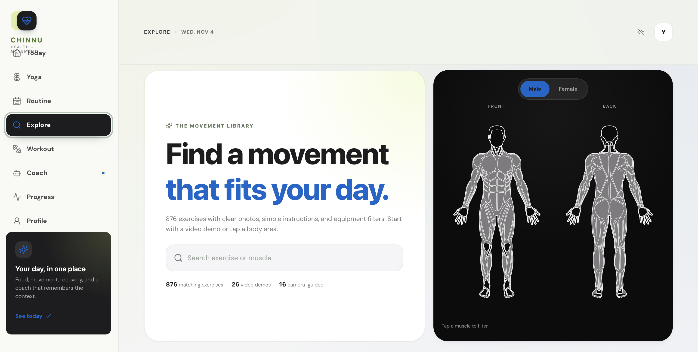
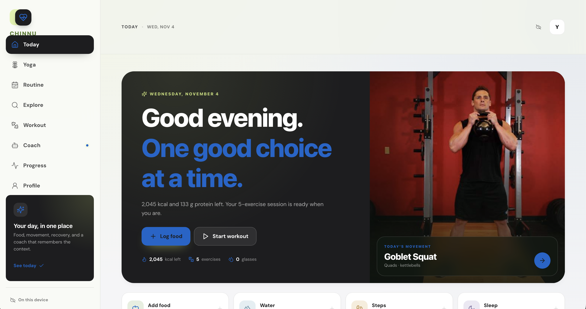

# Chinnu HealthAI - Comprehensive Report

**Live Website:** [https://chinnu-healthai-v2.onrender.com/](https://chinnu-healthai-v2.onrender.com/)  
**GitHub Repository:** [https://github.com/ChinmayRERC/chinnu-healthai](https://github.com/ChinmayRERC/chinnu-healthai)  
**Date:** November 4, 2026

---

## Table of Contents

1. [Overview](#overview)
2. [Screenshots](#screenshots)
3. [Core Features](#core-features)
4. [Architecture](#architecture)
5. [Technology Stack](#technology-stack)
6. [AI & ML Capabilities](#ai--ml-capabilities)
7. [User Flow](#user-flow)
8. [Database Schema](#database-schema)
9. [Security & Privacy](#security--privacy)
10. [Deployment](#deployment)
11. [Future Enhancements](#future-enhancements)

---

## Overview

Chinnu HealthAI is a comprehensive, privacy-focused health and fitness companion web application designed to help users track their nutrition, movement, recovery, and overall wellness in one unified platform. The app combines traditional fitness tracking with cutting-edge AI capabilities including computer vision for form coaching, food recognition, and an intelligent AI coach.

The application follows a privacy-first approach with local-first data storage by default, optional cloud sync via Supabase, and on-device ML processing where possible.

---

## Screenshots

### Dashboard View


### Workout Interface


### Login/Authentication Page


---

## Core Features

### 1. **Today Dashboard**
- **Daily Overview** - At-a-glance view of calories, steps, water intake, sleep, and weight
- **Quick Actions** - Log meals, water, steps, sleep, and weight with minimal taps
- **Workout Suggestions** - Personalized workout recommendations based on profile and goals
- **Progress Summary** - Visual indicators showing daily goal completion

### 2. **Nutrition & Food Tracking**
- **Manual Food Logging** - Add meals by type (Breakfast, Lunch, Dinner, Snacks) with detailed nutrition info
- **AI Food Recognition** - Snap a photo of any meal and get instant nutrition estimates (calories, protein, carbs, fat, fiber)
- **Meal History** - Track all meals with timestamps and nutritional breakdown
- **Smart Portion Estimation** - AI estimates serving sizes for Indian and global cuisines

### 3. **Workout & Exercise**
- **Exercise Library** - Comprehensive database of exercises with detailed instructions, muscle groups, and difficulty levels
- **Custom Workouts** - Build and save personalized workout routines
- **Workout Player** - Guided workout sessions with timers, sets/reps tracking
- **Exercise Detail Pages** - Step-by-step guides, tips, and video demonstrations
- **Routine Planner** - Create multi-day workout programs

### 4. **Yoga**
- **Yoga Library** - Collection of yoga poses and flows
- **Guided Sessions** - Step-by-step yoga practice with form guidance
- **AI Form Coach** - Real-time pose analysis and corrections during practice

### 5. **AI Coach**
- **Conversational Assistant** - Chat with Chinnu AI about fitness, nutrition, recovery, and health
- **Context-Aware** - Understands your goals, progress, and current state
- **Practical Advice** - Actionable recommendations tailored to your needs
- **Safety-First** - Prioritizes safe exercise and evidence-based advice

### 6. **Real-Time AI Vision Coach**
- **Camera-Based Coaching** - Use your device camera for live form analysis
- **15+ Tracked Exercises** - Supported movements including squats, pushups, lunges, and more
- **Live Cues** - Real-time feedback on form, alignment, and technique
- **Rep Counting** - Automatic rep counting with form validation
- **Session History** - Save coaching sessions with scores and feedback

### 7. **Progress & Analytics**
- **Weight Tracking** - Log and visualize weight trends over time
- **Activity Metrics** - Track steps, calories burned, and active time
- **Recovery Tracking** - Monitor sleep quality and water intake
- **Workout History** - Review past sessions and performance
- **Visual Charts** - Trend graphs for all tracked metrics

### 8. **Profile & Cloud Sync**
- **User Profile** - Set goals, experience level, equipment, units (metric/imperial)
- **Supabase Authentication** - Secure sign-in with email magic link, Google, or GitHub
- **Cloud Sync** - Optional sync across devices with Supabase
- **Local-First** - Works offline with localStorage, syncs when online
- **Per-User Security** - Row-level security (RLS) ensures data isolation

---

## Architecture

### Frontend Architecture
```
src/
├── components/     # Reusable UI components (Layout, Modals, etc.)
├── pages/          # Main pages (Today, Workout, Yoga, Coach, etc.)
├── lib/            # Core logic (store, auth, AI, ML)
├── styles/         # CSS stylesheets
└── types/          # TypeScript type definitions
```

### Backend Architecture (Supabase)
```
supabase/
├── functions/      # Edge Functions (serverless)
│   ├── agent/           # AI chat coach
│   ├── coach-vision/    # Real-time vision coaching
│   ├── food-recognize/  # Food image recognition
│   └── meals-store/     # Meal storage API
├── migrations/     # Database migrations
└── sql/            # SQL setup scripts
```

### Data Flow
1. **Client** (React app) communicates with Supabase
2. **Auth** handled by Supabase Auth
3. **Data** stored in Supabase Postgres with RLS
4. **AI Features** route through Supabase Edge Functions
5. **ML Processing** runs on-device (TensorFlow.js/MediaPipe)

---

## Technology Stack

| Category | Technologies |
|----------|-------------|
| **Frontend Framework** | React 19.1.1, TypeScript 5.8.3 |
| **Build Tool** | Vite 7.1.7 |
| **Routing** | React Router DOM (via state-based routing) |
| **Styling** | CSS3 with custom design system |
| **Icons** | Lucide React |
| **Authentication** | Supabase Auth |
| **Database** | Supabase Postgres |
| **Serverless Functions** | Supabase Edge Functions (Deno) |
| **AI/LLM** | NVIDIA API (LLaMA 3.1 70B, Nemotron Nano 12B VL) |
| **Computer Vision** | TensorFlow.js, MediaPipe |
| **PWA** | Service Worker, Web App Manifest |
| **Deployment** | Render (Frontend), Supabase (Backend) |

---

## AI & ML Capabilities

### 1. AI Chat Coach
- **Model:** Meta LLaMA 3.1 70B Instruct via NVIDIA API
- **Context:** User profile, goals, recent activity, meals
- **Response:** Practical, actionable advice with safety considerations
- **Fallback:** Graceful degradation if API unavailable

### 2. Food Recognition
- **Model:** NVIDIA Nemotron Nano 12B VL (Vision-Language Model)
- **Input:** Base64 encoded food image
- **Output:** Food name, serving size, calories, macros, confidence score
- **Cuisine:** Optimized for Indian and global foods
- **Accuracy:** Returns alternatives and reasoning notes

### 3. Real-Time Vision Coaching
- **Model:** NVIDIA Nemotron Nano 12B VL
- **Processing:** Frame-by-frame analysis via camera
- **Feedback:** One clear cue at a time, natural coaching style
- **Focus:** Form correction, safety, breathing, alignment
- **Exercise Support:** Squats, pushups, lunges, planks, and more

### 4. On-Device Pose Detection
- **Library:** TensorFlow.js with MoveNet/BlazePose
- **Processing:** Real-time pose estimation in browser
- **Features:** Joint tracking, angle calculations, rep counting
- **Privacy:** All pose data processed locally, no video sent to server

---

## User Flow

1. **Onboarding** - First-time users complete profile (goals, experience, equipment, units)
2. **Dashboard** - View daily summary and quick actions
3. **Track** - Log meals, water, activity throughout the day
4. **Train** - Do workouts with guided player or AI vision coach
5. **Coach** - Ask AI coach for advice or get real-time form feedback
6. **Progress** - Review trends and adjust goals
7. **Sync** - Optionally sign in to sync across devices

---

## Database Schema

### Tables

#### `meals`
```sql
id BIGSERIAL PRIMARY KEY
user_id TEXT NOT NULL
meal_type TEXT (breakfast|lunch|dinner|snack)
name TEXT NOT NULL
calories NUMERIC
protein NUMERIC
carbs NUMERIC
fat NUMERIC
fiber NUMERIC
quantity TEXT
source TEXT (manual|camera)
image_data TEXT
recognized_at TIMESTAMPTZ
created_at TIMESTAMPTZ
```

#### `health_state`
```sql
user_id UUID PRIMARY KEY REFERENCES auth.users(id)
state JSONB (complete app state)
updated_at TIMESTAMPTZ
```

**Security:** Row Level Security (RLS) enabled on all tables. Users can only access their own data.

---

## Security & Privacy

- **Local-First by Default** - All data stored in browser localStorage
- **Optional Cloud Sync** - User must explicitly sign in
- **Row Level Security** - Database enforces per-user data isolation
- **No Password Storage** - Uses magic links and OAuth (no passwords)
- **On-Device ML** - Pose detection runs entirely in browser
- **API Key Protection** - All AI API keys stored as server-side secrets in Supabase
- **CORS Protection** - Proper CORS headers on all Edge Functions
- **HTTPS Only** - All traffic encrypted in transit

---

## Deployment

### Frontend (Render)
- **URL:** https://chinnu-healthai-v2.onrender.com/
- **Build Command:** `npm run build`
- **Start Command:** `npm run start` (serves static files)
- **Auto-Deploy:** Enabled from GitHub main branch

### Backend (Supabase)
- **Project:** pkoxfstyqqowfpytamlq
- **Functions:** Deployed via Supabase CLI
- **Database:** Managed Postgres with RLS
- **Auth:** Supabase Auth configured

### CI/CD
- Push to GitHub main branch triggers auto-deployment on Render
- Supabase functions deployed manually via CLI

---

## Future Enhancements

- [ ] **Social Features** - Share workouts and progress with friends
- [ ] **Meal Plans** - AI-generated meal plans based on goals
- [ ] **Wearable Integration** - Connect to Fitbit, Apple Health, Google Fit
- [ ] **Nutrition Database** - Expanded Indian food database
- [ ] **Workout Reminders** - Push notifications for workouts
- [ ] **Progress Photos** - Photo timeline with comparisons
- [ ] **AI Recipe Suggestions** - Generate recipes from available ingredients
- [ ] **Offline Mode** - Full offline functionality for core features

---

**Built with ❤️ for health and fitness**  
*Chinnu HealthAI - Your personal health companion*
